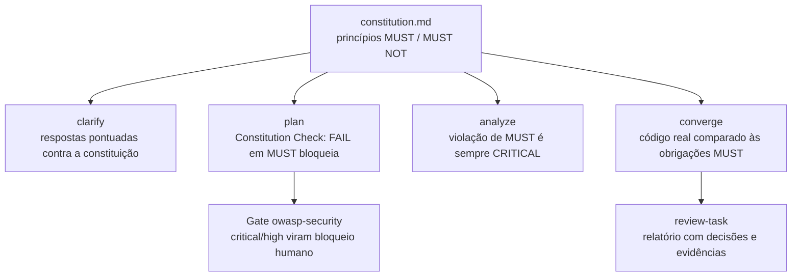
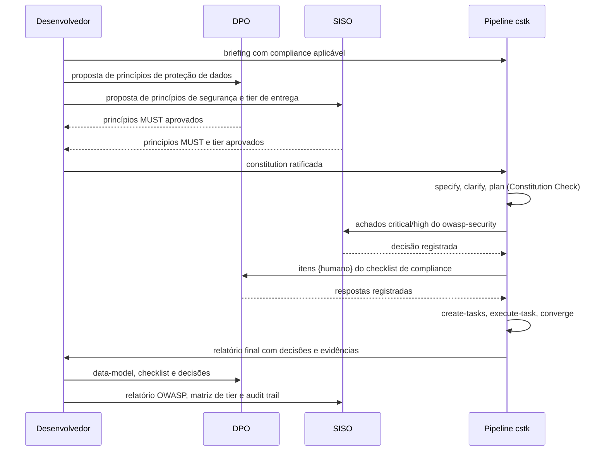

# OWASP, LGPD e a reunião que ninguém quer ter no fim do projeto: documentação como evidência para desenvolvedor, DPO e SISO

Todo time que constrói software com dado pessoal conhece esta cena. A aplicação está pronta, o deploy está agendado e alguém lembra que o jurídico e a segurança precisam "dar o ok". Começa a reunião.

O DPO pergunta quais dados pessoais a aplicação trata, com qual finalidade e por quanto tempo eles ficam guardados. O SISO, responsável pela segurança da informação, pergunta qual foi o modelo de ameaças, quem revisou a autenticação e onde estão os logs de acesso. O desenvolvedor responde abrindo o código.

São três idiomas diferentes tentando chegar a um mesmo veredito, e quase sempre a conversa termina com uma planilha montada às pressas, reconstruída de memória, que ninguém consegue provar que corresponde ao que foi de fato implementado.

Neste artigo quero mostrar como o **cstk**, o toolkit open source que venho construindo para o Claude Code, ataca esse problema de um jeito específico: tratando a documentação gerada não como subproduto, mas como **contrato auditável**, amarrado a uma constituição de projeto e verificado por gates de qualidade, de segurança (OWASP) e de conformidade (LGPD).

Um aviso antes de começar, porque ele é importante para quem trabalha com segurança e privacidade: o cstk **não é** parecer jurídico, **não é** pentest e **não é** certificação. Ele organiza a pergunta, a decisão e a evidência. Quem decide continua sendo o DPO, o SISO e o jurídico. E, como você vai ver, o próprio toolkit deixa isso explícito.

---

## A ideia central: a constituição como ponto de amarração

O cstk conduz um pipeline de desenvolvimento dirigido por especificação (SDD): `briefing`, `constitution`, `specify`, `clarify`, `plan`, `checklist`, `create-tasks`, `execute-task`, `converge` e `review-task`. Cada fase produz um artefato em `docs/` e cada artefato é verificado antes da fase seguinte.

A peça que amarra tudo é a **constituição do projeto** (`docs/constitution.md`): um documento curto de princípios declarativos e testáveis, versionado com SemVer, que só muda por emenda formal (via spec própria, com bump MAJOR, MINOR ou PATCH conforme o impacto).

O detalhe que faz diferença para auditoria é o formato. Toda obrigação é escrita como uma linha rotulada `**MUST:**` ou `**MUST NOT:**`, e não como prosa solta. Isso permite que ferramentas determinísticas extraiam as obrigações e cobrem cada uma delas ao longo do pipeline.

Um exemplo ilustrativo de princípio que um projeto com dado pessoal poderia ratificar junto com o DPO e o SISO:

```markdown
### III. Proteção de Dados Pessoais desde a Concepção (NON-NEGOTIABLE)

**MUST:**

- Todo campo que armazena dado pessoal é identificado no data-model.md,
  com finalidade e base legal declaradas.
- Toda entidade com dado pessoal tem política de retenção e descarte especificada.
- Dado pessoal sensível é criptografado em repouso.
- Logs registram eventos de autenticação e autorização sem expor dado pessoal
  em claro nem credenciais.

**MUST NOT:**

- Coletar dado pessoal sem requisito funcional que justifique a finalidade.
```

A partir do momento em que esse princípio está ratificado, ele deixa de ser uma intenção e passa a ser cobrado em quatro pontos diferentes do pipeline:



> **[IMAGEM: diagrama acima exportado do Mermaid]**

- No **`clarify`**, quando o orquestrador responde dúvidas da spec sozinho, cada opção recebe uma pontuação de 0 a 3 contra o briefing e a constituição. Uma opção que viola a constituição não é escolhida, e pontuação zero pausa a execução para um humano decidir.
- No **`plan`**, o *Constitution Check* é um gate obrigatório: uma tabela com cada princípio marcado como PASS, FAIL ou N/A. FAIL em princípio MUST interrompe o plano até ser resolvido.
- No **`analyze`**, a consistência entre spec, plano, tarefas e constituição é auditada em modo somente leitura, e violação de MUST é classificada sempre como CRITICAL.
- No **`converge`**, o pipeline volta a olhar o **código** e compara com o que foi especificado e com as obrigações extraídas da constituição. Divergência que viola MUST escala automaticamente de severidade.

Para o DPO e o SISO, isso muda a natureza da conversa. Em vez de "confie em nós, a gente cuidou disso", o time apresenta: "este é o princípio que vocês aprovaram, este é o gate que o cobrou, este é o resultado".

---

## LGPD: do briefing ao inventário de dados

A conformidade com a LGPD não entra no fim. Ela aparece desde a primeira conversa.

**No briefing**, a entrevista de descoberta tem uma dimensão de qualidade e padrões em que "segurança primeiro: OWASP, auditoria, compliance (LGPD/GDPR)" é uma das opções, e o template do briefing tem um campo explícito de compliance aplicável. Se o projeto trata dado pessoal, isso fica registrado antes de qualquer linha de código.

**No plano técnico**, o `data-model.md` lista entidades, campos e relacionamentos. Para o DPO, esse é o ponto de partida natural para o registro das operações de tratamento (art. 37 da LGPD) e para um eventual relatório de impacto à proteção de dados (art. 38). O inventário não precisa ser reconstruído de memória: ele nasce junto com o desenho da solução.

**No checklist de requisitos**, o domínio de segurança traz itens específicos de conformidade e proteção de dados, entre eles:

- Os requisitos de LGPD/GDPR/PCI/HIPAA aplicáveis estão mapeados?
- O direito de consentimento e de remoção de dados (onde aplicável) está definido?
- Retenção e descarte de dados têm política definida?
- Os logs contêm dados suficientes para análise forense sem vazar segredos?

Dois detalhes tornam esse checklist útil numa auditoria. Primeiro, ele testa a **qualidade do requisito**, não o código: a pergunta é "a spec diz o que acontece com o dado?", e não "o código funciona?". Segundo, cada item tem dono declarado. Itens `{auto}` são resolvidos pelo agente com citação da spec ou marcados como lacuna (`[Gap]`). Itens `{humano}` dependem de trade-off de negócio ou de interpretação, e é exatamente aí que entram o DPO e o jurídico. Pelo menos 80% dos itens precisam apontar para uma seção da spec ou para um marcador explícito de lacuna, ambiguidade ou premissa.

Inclusive a resposta "não se aplica" vira evidência. Num checklist real do próprio cstk, o item de compliance foi fechado como não aplicável **com justificativa**: a feature não processa dado pessoal, financeiro ou de saúde, nenhum requisito toca dado de usuário final, e isso foi confirmado pela ausência de qualquer menção a dado sensível na spec. Para um DPO, um "N/A" justificado e rastreável vale muito mais do que um campo em branco.

Por fim, **toda decisão** tomada pelo orquestrador é registrada com contexto, alternativas consideradas, escolha, justificativa e pontuação. A pontuação máxima, que autoriza decidir sem perguntar a ninguém, exige evidência literal: o comando executado e um trecho do resultado. Sem evidência, o próprio runtime recusa o registro. Isso conversa diretamente com o princípio de responsabilização e prestação de contas da LGPD (art. 6º, X) e com a ideia de segurança desde a concepção (art. 46, §2º): não basta ter feito, é preciso conseguir demonstrar.

---

## OWASP: segurança como gate, não como revisão opcional

A skill `owasp-security` cobre OWASP Top 10:2025, ASVS 5.0, API Security Top 10, CI/CD Top 10, LLM Top 10, os riscos de IA agêntica de 2026, NIST SP 800-63B-4, OAuth 2.1, FAPI 2.0, WebAuthn e criptografia pós-quântica. Ela pode ser usada de forma avulsa para revisar um diff, mas o ponto interessante é como os orquestradores a utilizam.

Depois do `plan`, ela roda como **gate de segurança** sobre a arquitetura proposta. Achados `critical` ou `high` geram **bloqueio humano obrigatório**: o pipeline para e alguém com autoridade precisa decidir. Não existe "anotar para depois".

### Rigor proporcional ao risco, com trilha de auditoria

Nem toda aplicação tem a mesma superfície de ataque. O cstk resolve isso com uma matriz de **tier de entrega** versionada:

| Tier de entrega | Modo do gate `owasp-security` |
|-----------------|-------------------------------|
| `local` | skip, com decisão registrada |
| `internal-network` | leve: autenticação, segredos e validação de entrada |
| `cloud-internal` | completo |
| `cloud-public` | completo |

Três regras tornam essa matriz defensável diante de um SISO:

1. **Fail-safe na direção do rigor.** Qualquer combinação não listada, ou arquivo de política ausente, resolve para `completo`. Nenhuma falha produz `skip`.
2. **Todo atalho é registrado.** Quando o gate roda leve ou é pulado, fica gravada uma decisão com o tier e o modo resolvido. O relatório final lista cada uma delas. Atalho sem decisão correspondente vira, ele próprio, um achado.
3. **Mudar o tier exige consentimento.** Se o tier de entrega muda no meio da execução sem consentimento registrado do operador, o relatório levanta um achado de severidade HIGH. Ninguém "rebaixa" o projeto para `local` em silêncio para escapar do gate.

### O carve-out que nasceu do próprio gate

O backlog gerado omite, para tiers locais, as fases de infraestrutura de produção (dashboards, SLOs, autoescala). Quando o próprio cstk passou pelo seu gate de segurança, um achado classificado como OWASP A09 (falhas de logging e monitoramento) apontou o risco óbvio: essa omissão poderia levar junto os logs de segurança.

O resultado foi uma regra explícita: logs de autenticação e autorização e trilha de auditoria **nunca** são omitidos, em nenhum tier. A omissão cobre escala operacional, jamais rastreabilidade de segurança. É um bom exemplo do ciclo completo: o gate encontrou o problema, o achado virou decisão e a decisão virou regra versionada.

### Escopo honesto

A própria skill declara, logo no início, que é um **assistente de revisão guiado por checklist**: útil para varrer um diff, elevar o piso de segurança e priorizar, mas que não substitui auditoria formal, pentest ou certificação, e cujos achados são pontos de partida, não veredito. Para um SISO, ferramenta que declara o próprio limite é mais confiável do que ferramenta que promete cobertura total.

---

## As políticas do próprio cstk: praticar o que se cobra

Seria incoerente cobrar privacidade e segurança dos projetos sem aplicá-las ao toolkit. A constituição do próprio cstk tem princípios inegociáveis que respondem às perguntas que um DPO ou um SISO fariam sobre a ferramenta em si.

**Zero coleta remota (Princípio IV).** Nenhuma skill envia telemetria, analytics ou relatório de erro para fora. A política de privacidade (`PRIVACY.md`) lista, em tabela, tudo o que o cstk grava e onde: estado das execuções, índice de conhecimento, log do guard de comandos. Tudo local, em arquivos que o usuário controla. Os contadores de uso são opt-in e vêm desligados.

**Redação de segredos, sem promessa exagerada.** O conteúdo que vai para estado, logs e índice passa por um filtro que substitui padrões de credencial por `[REDACTED]`. E a política diz com todas as letras que isso reduz exposição, mas **não é garantia**.

**Fail-closed onde importa.** A política de segurança (`SECURITY.md`) documenta os hooks que interceptam comandos durante execuções autônomas. Se o mecanismo de verificação falhar, o comando é bloqueado, não liberado. Cada decisão do guard vai para um log local de auditoria. Downloads de release só aceitam hosts de uma lista permitida e são verificados por checksum SHA-256.

**Zero fabricação (Princípio VI).** Este talvez seja o mais relevante para o jurídico. Nenhum artefato pode conter dado factual inventado: nomes de campos de payload, endpoints, valores, status ou datas só entram se vierem de fonte rastreável. Sem fonte, a ação correta é bloqueio humano. Existe um subagente somente leitura que classifica cada dado concreto de um artefato como SOURCED, UNSOURCED ou PROPOSAL. Pense no que isso significa para um inventário de dados pessoais: um inventário com campos inventados é pior do que nenhum inventário, porque passa por verdade.

---

## A reunião a três, com o material na mesa

Com esses mecanismos, a reunião do início do artigo muda de formato. Cada pergunta tem um artefato que a responde:

| Quem pergunta | Pergunta | Onde está a resposta |
|---------------|----------|----------------------|
| DPO | Quais dados pessoais a aplicação trata? | `data-model.md` e requisitos funcionais da spec |
| DPO | Por quanto tempo guardamos e como descartamos? | Itens de compliance do checklist e requisitos de retenção |
| DPO | Por que essa decisão foi tomada? | Registro de decisões com alternativas, justificativa e evidência |
| SISO | Qual é a superfície de ataque? | Relatório do gate `owasp-security` após o `plan` |
| SISO | Por que o gate rodou em modo leve? | Decisão registrada com tier e modo resolvido pela matriz |
| SISO | Onde estão os logs de autenticação? | Tarefas de audit trail no `tasks.md`, nunca omitidas |
| Jurídico | O código ainda corresponde ao que foi aprovado? | Relatório do `converge` (código versus spec e constituição) |
| Desenvolvedor | O que é inegociável neste projeto? | Princípios MUST da constituição |

Dois recursos complementam essa conversa. O `cstk recall` consulta o índice de conhecimento com proveniência (projeto, feature, onda e data), permitindo responder *como* uma decisão foi tomada meses depois. E a skill `presentation` gera, a partir dos mesmos documentos, um deck executivo em HTML para quem não vai ler specs, com fatos e métricas extraídos de um inventário determinístico.

> **[IMAGEM: exemplo de relatório do review-task listando decisões de gate com justificativa]**

---

## Um roteiro prático para validar a aplicação com jurídico e segurança

Na prática, o fluxo que proponho para times que precisam dessa validação é este:



1. **Briefing** com compliance declarado desde o início.
2. **Constituição co-assinada**: DPO e SISO aprovam os princípios MUST de proteção de dados e de segurança. A partir daqui, eles não precisam revisar cada linha de código para saber o que está sendo cobrado.
3. **Spec e plano** passam pelo Constitution Check, e o `data-model.md` já sai com o inventário de dados.
4. **Checklist de segurança e compliance**: os itens `{humano}` vão para quem tem autoridade para respondê-los.
5. **Gate OWASP** conforme o tier de entrega aprovado, com bloqueio humano para achados graves.
6. **Execução e `converge`** antes da entrega, para provar que o código corresponde ao que foi aprovado.
7. **Mudou a regra? Emenda formal.** Nova exigência do jurídico vira emenda versionada da constituição, não um combinado de corredor.

---

## Os limites (porque eles existem)

Seria desonesto encerrar sem eles:

- **O cstk não substitui o DPO, o SISO nem o jurídico.** Ele estrutura perguntas e evidências; a interpretação da base legal, o apetite de risco e a aceitação final continuam humanos.
- **Cobertura de checklist não é verificação exaustiva.** O gate OWASP eleva o piso; ele não elimina a necessidade de pentest e de auditoria formal em sistemas críticos.
- **A constituição vale o que está escrito nela.** Se uma obrigação for escrita como prosa solta em vez de linha `MUST:` rotulada, ela fica invisível aos gates automáticos. O próprio cstk reporta isso (cobertura de MUST "zero-reconhecida"), mas alguém precisa ler o aviso.
- **A redação de segredos é por padrão conhecido.** Credenciais em formato incomum podem passar. Diretórios de estado devem ser tratados como arquivos de trabalho e revisados antes de qualquer publicação.
- **Documentação desatualizada destrói a confiança.** Por isso existem o `converge` (o código alcança a spec) e o `reconcile-docs` (a documentação acompanha o código). Sem rodar um deles depois de correções pontuais, o artefato que você leva para a reunião pode já não descrever a aplicação real.

---

## O que fica

Conformidade e segurança raramente falham por falta de boa vontade. Falham porque a decisão foi tomada em uma conversa que ninguém registrou, por alguém que não sabia que aquele campo era dado pessoal, sob uma regra que nunca foi escrita de forma verificável.

O que o cstk propõe é simples de enunciar: **escrever a regra uma vez, de forma testável, com quem tem autoridade sobre ela, e fazer cada fase do desenvolvimento prestar contas a essa regra**. O resultado é que a reunião do fim do projeto deixa de ser uma reconstrução e passa a ser uma leitura.

O cstk é open source (MIT) e está no GitHub em **JotJunior/cstk**. Se você atua como DPO, SISO, jurídico ou desenvolvedor e tem críticas a essa abordagem, especialmente sobre o que ela ainda não cobre, quero muito ouvir.

---

*As referências a artigos da LGPD (Lei nº 13.709/2018) indicam onde os artefatos ajudam a produzir evidência; não constituem orientação jurídica. Os mecanismos descritos (gates, matriz de tier, registro de decisões, políticas) estão documentados no próprio repositório do cstk.*
