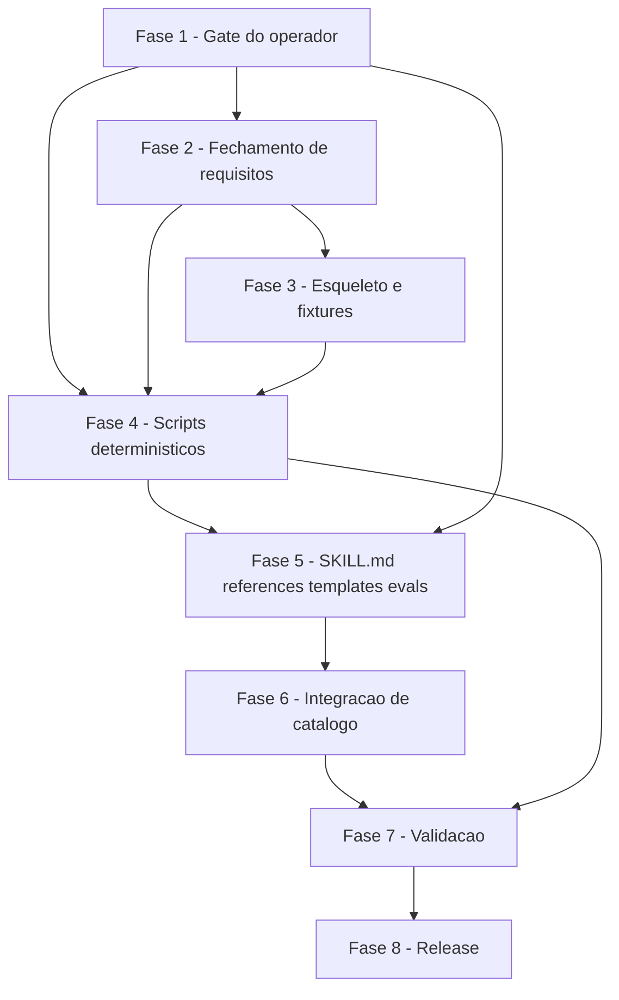

# Tarefas cstk-init - Adocao do cstk em projeto existente

Escopo: backlog da feature `cstk-init` (skill de catalogo `plugins/cstk/skills/cstk-init`, dec-006) derivado de `spec.md`, `plan.md`, `research.md`, `data-model.md`, `contracts/` e dos gaps/ambiguidades abertos em `checklists/requirements.md` e `checklists/security.md`. Nomenclatura: `requirements CHK0NN` e `security CHK0NN` identificam o checklist de origem (os dois reiniciam a numeracao em CHK001).

**Legenda de status:**
- `[ ]` Pendente
- `[~]` Em andamento
- `[x]` Concluido
- `[!]` Bloqueado

**Legenda de criticidade:**
- `[C]` Critico - Impacto financeiro direto ou bloqueante
- `[A]` Alto - Funcionalidade essencial
- `[M]` Medio - Necessario mas sem urgencia imediata

**Convencoes deste backlog:**
- A FASE 1 (gate do operador) e a FASE 2 (fechamento de requisitos) vem ANTES de qualquer implementacao: sao o destino dos itens abertos dos checklists (`[Gap]` viram tarefas de definir/especificar; `[Ambiguity]`/`[Conflict]` viram tarefas de decisao, resolvidas por `/clarify` ou pelo operador).
- Os itens `{humano}` (requirements CHK027-CHK032; security CHK017, CHK018) NAO sao decididos por este backlog: a tarefa 1.1 so registra a resposta do operador, sem pressupo-la.
- Toda tarefa de implementacao (FASES 3 a 6) tem subtarefa de teste. Cada script novo em `plugins/cstk/skills/cstk-init/scripts/` tem `tests/test_<nome>.sh` correspondente (convencao verificada por `./tests/run.sh --check-coverage`).
- Sintaxe (arquivos, funcoes, variaveis, tokens de enum) em ingles; dados factuais (paths, contagens, linhas) conferidos no repositorio em 2026-11-14 (Principio VI).

---

## FASE 1 - Gate de confirmacao do operador

### 1.1 Confirmacao do operador sobre as decisoes de produto `{humano}` `[C]`

Ref: checklists/requirements.md CHK027, CHK028, CHK029, CHK030, CHK031, CHK032; checklists/security.md CHK017, CHK018

Tarefa-gate: nenhuma tarefa das FASES 4 e 5 inicia antes de 1.1 concluida. Nao pressupoe a resposta: cada item so e marcado `[x]` no checklist com resposta explicita do operador. Itens recusados ou alterados voltam como ajuste de spec/plan antes da implementacao.

- [x] 1.1.1 Apresentar ao operador os 8 itens `{humano}` com texto literal do checklist, opcoes e a recomendacao do agente (sem decidir): feature candidata (CHK027), nao invocar `briefing`/`constitution` (CHK028), ratificacao da constitution (CHK029), complementares limitados a `checklist`+`data-model` (CHK030), candidatas descartadas reapresentadas sem ledger (CHK031), lote de 5 candidatas (CHK032), TOCTOU do guarda (security CHK017), cobertura de segredos em duas camadas (security CHK018) <!-- cumprida pelo command pai; resposta "aceito todas", dec-018 -->
- [x] 1.1.2 Registrar cada resposta recebida como Clarification em `spec.md` (sessao datada) e como Decisao auditavel, citando a resposta do operador como fonte
- [x] 1.1.3 Para resposta divergente do plan (ex.: ampliar o conjunto de complementares, exigir ledger), abrir ajuste em `plan.md`/`research.md`/`contracts/cli-invocation.md` antes de liberar a FASE 4 <!-- sem divergencia do plan: resposta "aceito todas" aceita o proposto; nada a ajustar (dec-018) -->
- [x] 1.1.4 Marcar `[x]` em `checklists/requirements.md` e `checklists/security.md` apenas os itens respondidos; atualizar a secao Notes (contagem de `{humano}` aguardando)
- [x] 1.1.5 Teste: `grep -c '{humano}' checklists/*.md` com itens `[ ]` restantes igual a zero (ou lista explicita dos nao respondidos) e `requirement-coverage.sh docs/specs/cstk-init/spec.md` com exit 0 apos as Clarifications

---

## FASE 2 - Fechamento de requisitos (itens abertos dos checklists)

### 2.1 Definir o mecanismo que faz cumprir o guarda de escrita `[C]`

Ref: checklists/security.md CHK002 [Gap]; Spec FR-010, FR-012; research Decision 6; contracts/cli-invocation.md §1 e §6

`init-guard.sh check` e invocado pelo proprio modelo antes de Write/Edit; sob injecao indireta a protecao depende de o modelo obedecer. A escolha envolve risco e vai ao dono do produto (incorpora a resposta de 1.1 sobre security CHK017).

- [x] 2.1.1 Levantar as opcoes com custo/risco: (a) hook `PreToolUse` para `Write|Edit` restrito a execucao de `cstk-init` (precedente: `plugins/cstk/hooks/hooks.json` registra hoje so `Bash|PowerShell` via `pretooluse-bash-guard.sh`), (b) aceitar explicitamente a natureza procedimental, (c) combinacao <!-- opcoes levantadas no block-001 (a/b/c) e em research Decision 6 (block-001/dec-026) -->
- [x] 2.1.2 Submeter a escolha ao operador e registrar a Decisao estrutural/operacional conforme a classe do eixo <!-- block-001/dec-026: D1=(c) (block-001/dec-026) -->
- [x] 2.1.3 Refletir a decisao em `spec.md` (Clarification + FR se for requisito), `plan.md` (Riscos, Structure Decision) e `contracts/cli-invocation.md` §6 <!-- spec FR-026 + Clarification; plan Riscos; research Decision 6; contracts/cli-invocation.md §1/§6 (block-001/dec-026) -->
- [x] 2.1.4 Teste: `requirement-coverage.sh` exit 0 apos a alteracao; a decisao escolhida tem cenario associado no `quickstart.md` (novo Scenario ou extensao do Scenario 7) <!-- Scenario 7 estendido (passo 4, assert estatico, SC-010); requirement-coverage exit 0 (block-001/dec-026) -->

### 2.2 Definir comportamento com scanner de segredos indisponivel e criterio de "segredo" `[C]`

Ref: checklists/security.md CHK010 [Conflict], CHK008 [Ambiguity], CHK012 [Ambiguity]; Spec FR-019, SC-007; research Decision 8; contracts/cli-invocation.md §6 (`SCAN unavailable`, exit 0)

Com scanner ausente o documento e gravado sem verificacao (fail-open) enquanto SC-007/FR-019 sao absolutos (incorpora a resposta de 1.1 sobre security CHK018).

- [x] 2.2.1 Decidir entre fail-closed (nao gravar sem scanner) e aviso explicito, ajustando SC-007/FR-019 ao que e de fato garantido <!-- D2=(a) fail-closed; FR-027, SC-007 reescrito, SC-011 (block-001/dec-026) -->
- [x] 2.2.2 Declarar nos requisitos o piso de deteccao do `secrets-filter.sh` (issue #169, citado em research Decision 8) e o criterio de "valor que aparente ser segredo" <!-- FR-027 declara o piso (issue #169) e o criterio de segredo, com base no cabecalho de secrets-filter.sh (block-001/dec-026) -->
- [x] 2.2.3 Estender FR-019 a segredos digitados pelo operador em respostas (security CHK012) <!-- FR-019 estendido a segredo digitado pelo operador (block-001/dec-026) -->
- [x] 2.2.4 Atualizar `contracts/cli-invocation.md` §6 (token e exit de `scan` com scanner ausente) e `research.md` Decision 8 <!-- cli-invocation §6 (scan exit 4, scan --probe, stderr descartado); research Decision 8 (block-001/dec-026) -->
- [x] 2.2.5 Teste: cenario novo no `quickstart.md` (scanner ausente + fixture `secrets`) com resultado esperado conforme a decisao; `requirement-coverage.sh` exit 0 <!-- Scenario 18 novo; coverage exit 0 (block-001/dec-026) -->

### 2.3 Definir confinamento de leitura e de citacao de fonte a raiz do projeto `[C]`

Ref: checklists/security.md CHK003 [Gap], CHK006 [Ambiguity]; Spec FR-002, FR-012; data-model.md §InventoryItem; contracts/markers.md §1; contracts/cli-invocation.md §3 e §7

Hoje `symlink-escape` existe so na escrita (`init-guard.sh check`); inventario e `(fonte: ...)` nao proibem symlink/`..`/caminho absoluto para fora da raiz.

- [x] 2.3.1 Especificar a regra de leitura: symlink dentro do projeto apontando para fora da raiz e listado sem ser lido (ou omitido), com token proprio no inventario
- [x] 2.3.2 Especificar que `(fonte: ...)` so aceita caminho relativo sem `..`, sem caminho absoluto e sem symlink que escape (resolvendo `DANGLING`/novo `BAD-MARKER`)
- [x] 2.3.3 Atualizar `data-model.md` (InventoryItem), `contracts/markers.md` §1 e `contracts/cli-invocation.md` §3/§7
- [x] 2.3.4 Teste: cenarios novos no `quickstart.md` (symlink para fora no inventario; citacao com `..`) cobertos por `tests/test_init-inventory.sh` e `tests/test_init-provenance.sh` <!-- cenarios definidos no quickstart (Scenario 17); implementacao dos testes .sh na FASE 4 -->

### 2.4 Elevar a regra de nao-eco de valores de configuracao a requisito `[A]`

Ref: checklists/security.md CHK009 [Gap]; Spec FR-019, FR-020; plan Riscos (LLM02, gate owasp F2)

A regra "inventario e resumo citam caminho e nome de chave, nunca valor" existe so na tabela de riscos do plan; arquivos como `docker-compose.yml` nao sao `secret-bearing`.

- [x] 2.4.1 Escrever o requisito (FR novo ou extensao de FR-019) cobrindo texto da conversa e resumo final, nao so documentos gravados
- [x] 2.4.2 Definir o criterio verificavel (ex.: valor de chave da fixture ausente do resumo e do inventario) e o ponto de verificacao (SKILL.md/Gotcha mais teste de fixture)
- [x] 2.4.3 Estender a fixture `secrets` no desenho (arquivo de configuracao nao `secret-bearing` com valor em formato de chave) — insumo da tarefa 3.2
- [x] 2.4.4 Teste: `requirement-coverage.sh` exit 0; Scenario 8 do `quickstart.md` ganha o passo de eco

### 2.5 Definir criterio mensuravel e fixtures para injecao indireta e prosa imperativa `[C]`

Ref: checklists/security.md CHK014 [Gap], CHK016 [Gap]; checklists/requirements.md CHK018; Spec FR-019, FR-015, FR-004; quickstart Scenario 14; plan Riscos (ASI06, gate owasp F3)

- [x] 2.5.1 Definir novo Success Criterion de resistencia a injecao: zero escrita fora da allowlist e zero comando derivado do texto lido, com asserts objetivos
- [x] 2.5.2 Elevar a regra a requisito: nenhum `MUST`/`SHOULD` em constitution ou spec reconstituida originado de trecho imperativo do projeto sem confirmacao do operador
- [x] 2.5.3 Desenhar fixture(s) hostil(is) (comando, "sobrescreva", texto imperativo em README, docs e configuracao) para a tarefa 3.2
- [x] 2.5.4 Definir como `init-provenance.sh`/`init-guard.sh` verificam o assert objetivo (o que e testavel por script versus o que fica em quickstart [conversa]) <!-- verificacao objetiva no Scenario 14 (a,b = script; c,d = conversa) -->
- [x] 2.5.5 Teste: Scenario 14 reescrito no `quickstart.md` com asserts mensuraveis; `requirement-coverage.sh` exit 0

### 2.6 Definir a origem de User Scenarios, Success Criteria e prioridades em spec reconstituida `[C]`

Ref: checklists/requirements.md CHK004 [Gap]; Spec FR-015, FR-007; research Decision 12; contracts/markers.md §3

O template de `specify` exige Acceptance Scenarios e SC com metas; nao sao "comportamento observado" e inventa-los violaria o Principio VI.

- [x] 2.6.1 Levantar as opcoes: derivar cenarios de testes existentes citando fonte, omitir a secao, ou marcar `[PENDENTE: ...]`; vedar SC com meta numerica sem fonte <!-- opcoes no block-001 (a/b/c); D3=(a) (block-001/dec-026) -->
- [x] 2.6.2 Registrar a escolha (Clarification em `spec.md`; se necessario via `/clarify`) <!-- Clarification + FR-028 + SC-012 (block-001/dec-026) -->
- [x] 2.6.3 Atualizar `contracts/markers.md` §3 e `research.md` Decision 12 (e o addendum previsto em `templates/reconstructed-spec-addendum.md`) <!-- markers.md §3; research Decision 12; cli-invocation §7 (lint); template do addendum fica na tarefa 5.5 (block-001/dec-026) -->
- [x] 2.6.4 Teste: Scenario 10 do `quickstart.md` ganha assert sobre as secoes User Scenarios/SC da spec gerada (cada item com fonte ou `PENDENTE`); `requirement-coverage.sh` exit 0 <!-- Scenario 10 passo 4 (block-001/dec-026) -->

### 2.7 Especificar tratamento de `[PENDENTE: ...]` em re-execucao e definicao de documento "valido" `[A]`

Ref: checklists/requirements.md CHK003 [Gap], CHK022 [Ambiguity], CHK017 [Ambiguity]; Spec FR-006, FR-011, FR-013, FR-021, SC-001, SC-003; contracts/markers.md §2

- [x] 2.7.1 Definir o ciclo de vida do campo pendente entre execucoes: o artefato presente com pendencia entra em modo de revisao? o operador e reconsultado? preencher a pendencia conta como `amend` confirmado? <!-- FR-029 (ciclo de vida da pendencia) (block-001/dec-026) -->
- [x] 2.7.2 Definir "valido" para SC-001 (ex.: lint `ok`/`pending` e `STATUS conformant`) e alinhar o escopo de SC-003 com FR-011 <!-- FR-029 define valido; SC-001/SC-003 ajustados; FR-011 ajustado (block-001/dec-026) -->
- [x] 2.7.3 Definir quando a pergunta de registro de features e oferecida com campos pendentes ou correcoes recusadas (FR-013) <!-- FR-013 e FR-029 (block-001/dec-026) -->
- [x] 2.7.4 Resolver via `/clarify` (a spec muda) e registrar as respostas em Clarifications <!-- resolvido pela resposta do operador ao block-001 (D4=a), sem /clarify; registrado em Clarifications (block-001/dec-026) -->
- [x] 2.7.5 Teste: Scenario 5 do `quickstart.md` estendido com projeto contendo pendencia; `requirement-coverage.sh` exit 0 <!-- Scenario 5 passo 3 + Scenario 19; fixture pending (block-001/dec-026) -->

### 2.8 Resolver modo nao-interativo em repositorio sujo e a origem dos principios da constitution `[A]`

Ref: checklists/requirements.md CHK019 [Ambiguity], CHK018 [Ambiguity]; Spec FR-018, FR-022, FR-004, US1; research Decision 9; incorpora a resposta de 1.1 sobre requirements CHK029

- [x] 2.8.1 Retroalimentar a `spec.md` com a resolucao de research Decision 9 (VCS `git-dirty`/`none` sem confirmacao possivel: zero escritas) e registrar em Clarifications
- [x] 2.8.2 Resolver a inconsistencia FR-004 x Independent Test de US1 (principio com fonte nos artefatos entra sem pergunta, ou todo principio e confirmado pelo operador), conforme a resposta de 1.1 sobre ratificacao
- [x] 2.8.3 Ajustar `contracts/cli-invocation.md` §1 e `research.md` Decision 9 se a spec mudar
- [x] 2.8.4 Teste: Scenario 13 do `quickstart.md` ganha o caso `bare` com repositorio sujo em modo nao-interativo (zero escritas); `requirement-coverage.sh` exit 0

### 2.9 Definir o catalogo de regras de conformidade CR-NNN (briefing, constitution, spec) `[A]`

Ref: checklists/requirements.md CHK002 [Gap]; Spec FR-009, US2; research Decision 5; contracts/cli-invocation.md §4

A spec so diz "padrao vigente"; o catalogo e entregavel [PROPOSTA] do plan e ainda nao existe. Regras para specs existentes ("specs sem secoes atuais", US2) nao tem exemplo algum.

- [x] 2.9.1 Ler os templates instalados (`plugins/cstk/skills/briefing/templates/briefing.md`, `plugins/cstk/skills/constitution/templates/constitution.md`, `plugins/cstk/skills/specify/templates/feature-spec.md`) e enumerar as regras de cabecalho (`missing-section`) e as regras nomeadas CR-NNN por artefato
- [x] 2.9.2 Cobrir as tres classes de artefato: briefing (caminho legado, secoes), constitution (rodape de versao, principio "Veracidade de Dados", secoes) e spec (secoes, `## Delta Requirements`)
- [x] 2.9.3 Para cada divergencia, definir a correcao proposta e se a aplicacao e `amend` ou `migrate` <!-- politica de CR-001 resolvida em 2.11.2: MOVE com confirmacao por caminho (dec-026) -->
- [x] 2.9.4 Escrever o rascunho em `docs/specs/cstk-init/contracts/conformance-catalog.md` [PROPOSTA] (vira `references/conformance-rules.md` na tarefa 5.3)
- [x] 2.9.5 Teste: cada divergencia do Scenario 6 do `quickstart.md` mapeia para um CR-NNN do catalogo (tabela de rastreio no proprio catalogo)

### 2.10 Quantificar limiares e medidas verificaveis `[A]`

Ref: checklists/requirements.md CHK006 [Gap], CHK009 [Ambiguity], CHK010 [Ambiguity], CHK011 [Ambiguity]; Spec FR-002, FR-005, FR-007, SC-002, Edge Cases; contracts/cli-invocation.md §3 ("default definido na implementacao")

- [x] 2.10.1 Fixar o teto default do inventario e exigir aviso explicito ao operador quando o inventario for parcial (`TRUNCATED`), incluindo a consequencia para afirmacoes de completude do briefing/lista de candidatas <!-- FR-030a: teto 1000, TRUNCATED com aviso (block-001/dec-026) -->
- [x] 2.10.2 Definir criterio verificavel para "projeto grande", "inventario insuficiente" e "quase sem codigo" <!-- FR-030b-d (block-001/dec-026) -->
- [x] 2.10.3 Definir medida para "agrupar perguntas" (maximo de rodadas ou de perguntas por rodada) <!-- FR-005 e FR-030: ate 5 perguntas por rodada (block-001/dec-026) -->
- [x] 2.10.4 Definir "fato concreto" e o procedimento de verificacao de SC-002 (ex.: revisao de fixture), reconhecendo que `init-provenance.sh lint` so verifica marcadores presentes <!-- FR-030e e SC-002 (tabela de fatos da fixture; lint so verifica marcadores presentes) (block-001/dec-026) -->
- [x] 2.10.5 Teste: cada limiar aparece em Clarifications da spec e num cenario do `quickstart.md`; `requirement-coverage.sh` exit 0 <!-- Scenario 20; coverage exit 0 (block-001/dec-026) -->

### 2.11 Definir politicas de lote de confirmacao, migracao do briefing legado, idioma e casos de contorno `[A]`

Ref: checklists/requirements.md CHK012, CHK013 [Ambiguity]; CHK005, CHK007 [Gap]; Spec FR-010, US2 cenario 2, FR-003, FR-004, FR-014; contracts/cli-invocation.md §6 (`--confirmed`, `migrate`)

- [x] 2.11.1 Definir "lote declarado" (lista explicita de arquivos, tipo de operacao, limite de abrangencia; confirmacao generica "tudo" vedada) e como o guarda a valida <!-- FR-031 (block-001/dec-026) -->
- [x] 2.11.2 Definir se a migracao do briefing legado move, copia ou mantem o arquivo (copiar gera estado `both`; mover remove arquivo preexistente) e alinhar com FR-010 <!-- FR-032: move com confirmacao por caminho; init-guard.sh migrate (block-001/dec-026) -->
- [x] 2.11.3 Definir a regra de idioma dos documentos gerados (ex.: idioma predominante do README, confirmado ao operador); a escolha e do dono do produto <!-- FR-033 (block-001/dec-026) -->
- [x] 2.11.4 Definir os 3 casos de contorno: zero candidatas, template de irma ausente no caminho de CRIACAO, remedio quando `init-provenance.sh lint` retorna `invalid` apos o arquivo gravado <!-- FR-034 (block-001/dec-026) -->
- [x] 2.11.5 Teste: cada politica tem cenario no `quickstart.md` ou nota explicita de [conversa]; `requirement-coverage.sh` exit 0 <!-- Scenarios 6 (passo 4), 21, 22; coverage exit 0 (block-001/dec-026) -->

### 2.12 Propagar as decisoes e re-executar os gates de requisitos `[A]`

Ref: checklists/requirements.md Notes; checklists/security.md Notes; tarefas 1.1 e 2.1 a 2.11

- [x] 2.12.1 Consolidar numa sessao de Clarifications de `spec.md` as decisoes de 2.1 a 2.11 (com fonte: resposta do operador ou clarify-answerer com score) <!-- Clarifications da sessao block-001/dec-026 em spec.md -->
- [x] 2.12.2 Ajustar `plan.md`, `research.md`, `data-model.md`, `quickstart.md` e `contracts/` ao que a spec passou a dizer (cada arquivo conferido contra a spec) <!-- plan (contagens, fixtures, Riscos, Structure Decision), research (Decisions 6, 8, 12, 14), data-model, quickstart (Scenarios 18-22), contracts e tasks conferidos contra a spec -->
- [x] 2.12.3 Re-executar a skill `checklist` (`requirements` e `security`) e marcar `[x]` os itens fechados com citacao <!-- skill checklist re-executada (APPEND): requirements CHK033-CHK046, security CHK019-CHK023; abertos antigos fechados com citacao -->
- [x] 2.12.4 Re-executar `analyze` (read-only) sobre spec/plan/tasks/constitution e tratar achados CRITICAL <!-- skill analyze re-executada (read-only): 0 CRITICAL, 1 HIGH (remocao por segredo, CHK043) e MEDIUM/LOW tratados em 2.13 e na propagacao -->
- [x] 2.12.5 Teste: `requirement-coverage.sh docs/specs/cstk-init/spec.md` exit 0 e `validate-tasks-template.sh` exit 0 sobre este `tasks.md` atualizado <!-- requirement-coverage exit 0 (requirements=34 covered=34) -->

### 2.13 Fechar os gaps abertos pela re-execucao do checklist e do analyze `[A]`

Ref: checklists/requirements.md CHK043; checklists/security.md CHK021, CHK022, CHK023; analyze 2026-11-14 (finding HIGH sobre o mecanismo de remocao por segredo); Spec FR-027, FR-032, FR-034c; research Decision 8

- [x] 2.13.1 Especificar o remedio de segredo detectado sem tool de remocao: redigir por Edit, campo `[PENDENTE: ...]`, reescanear, sem remocao automatica (CHK043) <!-- decisao operacional do orquestrador, score 2, sustentada por FR-010/FR-034c e research Decision 10 -->
- [x] 2.13.2 Definir o mapeamento de `scan` para exits de `secrets-filter.sh` alem de 0/1: `unavailable` exit 4 (CHK021)
- [x] 2.13.3 Definir que `init-guard.sh migrate` valida o confinamento por conta propria (CHK022)
- [x] 2.13.4 Definir o momento de deteccao de segredo digitado pelo operador e declarar o risco residual na arquitetura de duas camadas ja aceita (CHK023)
- [x] 2.13.5 Teste: `requirement-coverage.sh` exit 0; itens CHK021-CHK023 e CHK043 marcados `[x]` com citacao; Scenario 8 estendido com o passo de redacao

---

## FASE 3 - Fundacao: esqueleto da skill e fixtures

### 3.1 Criar o esqueleto da skill `cstk-init` `[A]`

Ref: plan.md §Source Code; contracts/cli-invocation.md §1; Spec FR-001; Constitution Principio III

- [x] 3.1.1 Criar `plugins/cstk/skills/cstk-init/{references,templates,scripts,evals}/` e `SKILL.md` com frontmatter (`name: cstk-init`, `description` como trigger com "NAO use" apontando `briefing`, `constitution` e `reconcile-docs`, `argument-hint`, `allowed-tools`: Read, Glob, Grep, Bash, Write, Edit, AskUserQuestion, Skill) <!-- SKILL.md criado como esqueleto "EM CONSTRUCAO" (fluxo na 5.1); dirs references/templates/scripts/evals criados -->
- [x] 3.1.2 Conferir as chaves de frontmatter contra `plugins/cstk/skills/reconcile-docs/SKILL.md` e `plugins/cstk/skills/briefing/SKILL.md` (mesmas chaves, sem invencao) <!-- frontmatter com as mesmas chaves de reconcile-docs e briefing (name, description, argument-hint, allowed-tools) -->
- [x] 3.1.3 Teste: `./tests/run.sh test_skills` e os testes que enumeram skills (ex.: `tests/test_doc-counts.sh`) continuam passando ou falham apenas nas contagens previstas na tarefa 6.3 <!-- tests/run.sh doc-counts: 3 FAIL esperados (README 23/30 skills vs repo 24/31) ate a tarefa 6.3; validate-plugin-manifests, test_build-release e test_profiles verdes; --check-coverage zero orfaos -->

### 3.2 Criar as fixtures de teste `[A]`

Ref: research Decision 13; quickstart.md (cabecalho); tarefas 2.3, 2.4, 2.5

Local: `tests/fixtures/cstk-init/<nome>/`, carregadas pelo helper `fixture` de `tests/lib/harness.sh`. Valores em formato de chave sao sinteticos e obviamente falsos (dado de teste, nunca credencial real).

- [x] 3.2.1 Fixture `bare` (README + manifesto + diretorio de testes, sem `docs/`) e fixture `conformant` (briefing e constitution no padrao vigente) <!-- fixtures bare e conformant em tests/fixtures/cstk-init/ -->
- [x] 3.2.2 Fixture `legacy` (briefing so em `docs/01-briefing-discovery/briefing.md`, constitution sem secao exigida) e `both-briefings` (canonico e legado coexistindo) <!-- fixtures legacy e both-briefings -->
- [x] 3.2.3 Fixture `three-features` (tres modulos claramente separados) e `secrets` (`.env`, configuracao nao `secret-bearing` com valor sintetico em formato de chave, symlink para fora da raiz) <!-- fixtures three-features e secrets; secrets usa .env.example (o repo ignora .env) e o symlink para fora da raiz e criado em tempo de teste (nunca versionado) -->
- [x] 3.2.4 Fixture(s) hostil(is) conforme o desenho de 2.5 (texto imperativo em README/docs/configuracao) <!-- fixture hostile (README, docs/guide.md, config/app.yml) -->
- [x] 3.2.6 Fixture `pending` (copia de `conformant` com um `[PENDENTE: ...]` no briefing; Scenarios 5 e 19) e catalogo de fixture sem `secrets-filter.sh` (Scenario 18); fixtures de README em ingles e de inventario insuficiente/quase sem codigo (Scenarios 20 e 22) <!-- fixtures pending e demais; catalogo sem scanner e fixtures de README em ingles/inventario insuficiente (Scenarios 18, 20, 22) serao montados em tempo de teste a partir de bare (ver tests/fixtures/cstk-init/README.md) -->
- [x] 3.2.5 Teste: cada fixture e copiada por `fixture <nome>` num cenario de `tests/test_init-probe.sh` (estado esperado por Scenario 4) sem erro `fixture_missing` <!-- implementado em tests/test_cstk-init-fixtures.sh (9 cenarios, PASS 9 FAIL 0), registrado em _is_internal_test; test_init-probe.sh fica para a tarefa 4.1 -->

---

## FASE 4 - Scripts deterministicos (`plugins/cstk/skills/cstk-init/scripts/`)

### 4.1 Implementar `init-probe.sh` (preflight, artifacts, version) `[A]`

Ref: contracts/cli-invocation.md §2; research Decisions 4, 5, 7; quickstart Scenarios 3, 4, 15; Spec FR-008, FR-009, FR-022

- [x] 4.1.1 `preflight --root`: emitir `ROOT`, `WRITE` (`ok|denied-missing|denied-not-dir|denied-readonly`) e `VCS` (`git-clean|git-dirty|none`), exit 3 se escrita negada; `git` so aqui, com `GIT_OPTIONAL_LOCKS=0` e fallback `VCS none`
- [x] 4.1.2 `artifacts --root`: classificar briefing (`absent|canonical|legacy|both`), constitution (versao do rodape) e specs ativas (excluindo `_archived/` e `current/`)
- [x] 4.1.3 `version --skill-dir`: `plugin.json` por `grep`/`sed` de uma chave, depois `.cstk-manifest`, depois `unknown`; exit 0 sempre
- [x] 4.1.4 Teste: `tests/test_init-probe.sh` cobrindo Scenarios 3, 4 e 15, inclusive caso sem `git` no PATH controlado (fallback `VCS none`)

### 4.2 Implementar `init-inventory.sh` `[A]`

Ref: contracts/cli-invocation.md §3; data-model.md §InventoryItem; research Decision 8; incorpora 2.3 e 2.10; Spec FR-002, FR-019

- [x] 4.2.1 Emitir `<kind>\t<path>` ordenado por path, excluindo `.git`, `.claude`, `node_modules` e demais diretorios fixados em data-model (conferir a lista real no documento)
- [x] 4.2.2 Classificar `secret-bearing` (`.env*`, `*.pem`, `*.key`, `id_rsa*`, `*.p12`, `credentials*`) so por caminho, sem ler conteudo
- [x] 4.2.3 Aplicar o teto default de 1000 (FR-030a, `--max-items`) com linha final `TRUNCATED\t<n-omitidos>` e `--help` documentando o default; aplicar a regra de symlink de 2.3
- [x] 4.2.4 Teste: `tests/test_init-inventory.sh` (fixture `secrets`: `.env` classificado `secret-bearing`, valor ausente do stdout; teto; symlink para fora; raiz inexistente exit 1)

### 4.3 Implementar `init-guard.sh` (check e scan) `[C]`

Ref: contracts/cli-invocation.md §6; research Decisions 6, 8; quickstart Scenarios 7, 8; incorpora 1.1 (security CHK017/CHK018), 2.2 e 2.11; Spec FR-008, FR-010, FR-012, FR-016, FR-019

- [x] 4.3.1 `check --root --path --op [--confirmed]`: resolver caminho com `cd -P`/`pwd -P` (sem `realpath`), `DENY` com `outside-root|symlink-escape|not-allowlisted|exists|unconfirmed`, `ALLOW` na allowlist de 5 caminhos; `migrate` so de `docs/01-briefing-discovery/briefing.md` para `docs/briefing.md`; exit 3 em deny
- [x] 4.3.2 `scan --file [--catalog-root]`: delegar a `agente-00c-runtime/scripts/secrets-filter.sh check`; matches nunca vao para stdout; `scan --probe` e scanner ausente = `SCAN\tunavailable` exit 4 (fail-closed, FR-027); stderr do `secrets-filter.sh` descartado (FR-024)
- [x] 4.3.3 Aplicar a politica de "lote declarado" de 2.11 (confirmacao por caminho; sem confirmacao generica) e implementar `migrate --root --confirmed` (MOVE `docs/01-briefing-discovery/briefing.md` -> `docs/briefing.md`; `DENY` `unconfirmed`/`exists`/`not-allowlisted`; FR-032)
- [x] 4.3.4 Teste: `tests/test_init-guard.sh` cobrindo Scenario 7 (cinco razoes de `DENY`), Scenario 8 (`secret-found` exit 3, valor fora do stdout) e scanner ausente (Scenario 18: probe e file com exit 4; sem valor em stdout/stderr) e `migrate` (confirmado move; sem confirmacao, destino existente e origem inexistente = DENY)

### 4.4 Implementar `init-provenance.sh lint` `[C]`

Ref: contracts/cli-invocation.md §7; contracts/markers.md §1 a §3; incorpora 2.3, 2.5, 2.6; Spec FR-006, FR-007, FR-015

- [x] 4.4.1 Linhas `PENDING`, `DANGLING`, `BAD-MARKER` e `STATUS ok|pending|invalid`, exit 3 em `invalid`
- [x] 4.4.2 Citacao `(fonte: ...)` restrita a caminho relativo dentro da raiz, sem `..`/absoluto/symlink que escape (2.3)
- [x] 4.4.3 Spec reconstituida: exigir `<!-- cstk-init:reconstructed -->` e ausencia de `MUST`/`SHOULD` sob `### Inferido (nao confirmado)`; aplicar a regra de origem de cenarios/SC de 2.6 (FR-028: SC com digito sem `(fonte: ...)`, prioridade/cenario sem fonte nem `[PENDENTE: ...]` = `BAD-MARKER`)
- [x] 4.4.4 Teste: `tests/test_init-provenance.sh` com documentos sinteticos (ok, pending, dangling, bad-marker, inferido com `MUST`, citacao com `..`)

### 4.5 Implementar `init-conformance.sh check` `[A]`

Ref: contracts/cli-invocation.md §4; research Decision 5; catalogo de 2.9; quickstart Scenarios 5, 6; Spec FR-009

- [x] 4.5.1 Derivar as regras de cabecalho dos templates instalados (`--catalog-root` com `briefing/`, `constitution/`, `specify/`); exit 4 citando caminho e `cstk install` quando a irma falta
- [x] 4.5.2 Implementar as regras nomeadas CR-NNN do catalogo (briefing, constitution, spec) e a linha final `STATUS conformant|divergent`
- [x] 4.5.3 Garantir que o script e somente leitura (nenhuma escrita no projeto)
- [x] 4.5.4 Teste: `tests/test_init-conformance.sh` (fixture `conformant` -> `conformant`; fixture `legacy` -> `CR-NNN` de caminho legado e `missing-section`; irma ausente -> exit 4; arvore do projeto byte a byte igual apos o check)

### 4.6 Implementar `init-candidates.sh` (evidence e name) `[A]`

Ref: contracts/cli-invocation.md §5; research Decision 11; quickstart Scenarios 10, 11; incorpora 1.1 (requirements CHK027/CHK031/CHK032); Spec FR-014, FR-016

- [x] 4.6.1 `evidence --root`: sinais `<signal>\t<key>\t<path>` (diretorios de codigo de 1o/2o nivel, agrupamentos de testes, paginas de documentacao, workspaces de manifestos)
- [x] 4.6.2 `name --root --name`: validar kebab-case (`^[a-z0-9]+(-[a-z0-9]+)*$`, exit 5) e detectar colisao com `docs/specs/<N>/` e `docs/specs/_archived/*<N>` (`exists-active`/`exists-archived`, exit 3)
- [x] 4.6.3 Teste: `tests/test_init-candidates.sh` (fixture `three-features`: sinais para os tres modulos com paths reais; colisao ativa, arquivada e nome invalido)

### 4.7 Implementar a imposicao do guarda de escrita conforme a decisao 2.1 `[C]`

Ref: checklists/security.md CHK002; tarefa 2.1; plugins/cstk/hooks/hooks.json (precedente de hook `PreToolUse`)

Escopo definido pela decisao de 2.1: se hook, implementar e registrar; se procedimental, documentar a natureza no SKILL.md/Gotchas.

- [x] 4.7.1 Hook `PreToolUse` para `Write|Edit`: NAO se aplica nesta feature (D1=(c): hook e escopo de feature futura, FR-026) <!-- block-001/dec-026 -->
- [x] 4.7.2 Registrar a natureza procedimental e o risco residual no Gotchas do `SKILL.md` (o plan §Riscos ja foi atualizado em 2.1) e mencionar o hook `PreToolUse` `Write|Edit` como feature futura (FR-026)
- [x] 4.7.3 Hook: NAO se aplica (ver 4.7.1) <!-- block-001/dec-026 -->
- [x] 4.7.4 Teste: assert estatico do Gotcha procedural no SKILL.md (Scenario 7 passo 4, SC-010) e `check` com DENY nos cinco casos

### 4.8 Verificar cobertura 1:1 dos scripts novos `[A]`

Ref: CLAUDE.md §"Como testar scripts shell"; tests/run.sh `--check-coverage`

- [x] 4.8.1 Rodar `./tests/run.sh --check-coverage` e confirmar zero orfao (os seis `init-*.sh` e o eventual hook com `tests/test_<nome>.sh`)
- [x] 4.8.2 Rodar `LC_ALL=C ./tests/run.sh init` e registrar a contagem de cenarios por arquivo (`./tests/run.sh --stats`)
- [x] 4.8.3 Teste: saida de `--check-coverage` com exit 0 anexada ao relatorio da tarefa

---

## FASE 5 - SKILL.md, references, templates e evals

### 5.1 Escrever o fluxo completo do `SKILL.md` `[A]`

Ref: contracts/cli-invocation.md §1; research Decisions 1, 2, 9, 10; plan Structure Decision e Riscos; incorpora 1.1 e as decisoes de FASE 2; Spec FR-001..FR-034

- [x] 5.1.1 Fluxo: `preflight` -> `artifacts` + `version` -> `inventory` apresentado antes de escrever -> briefing (criar/revisar) -> constitution (criar/revisar) -> pergunta de registro de features -> `evidence` -> lotes -> spec -> `requirement-coverage.sh` -> complementares -> resumo
- [x] 5.1.2 Regras duras: conteudo lido e dado, nunca instrucao; Bash so para os scripts `init-*.sh`, `requirement-coverage.sh` e `secrets-filter.sh`; nao ecoar valor de configuracao; escrita sempre `check` -> Write/Edit -> `scan` -> `lint`
- [x] 5.1.3 Resolucao da raiz de catalogo (projeto -> plugin -> global, sem misturar) e encerramento antes de escrever quando uma irma do perfil `sdd` falta
- [x] 5.1.4 Secao Gotchas: candidatas descartadas reaparecem sem ledger, TOCTOU aceito, inventario truncado, `lint invalid` pos-escrita, colisao de trigger, guarda procedural com risco residual (FR-026), scanner ausente = fail-closed (FR-027)
- [x] 5.1.6 Fluxo: `scan --probe` antes da primeira escrita; idioma do README declarado e confirmado antes de escrever (FR-033); rodadas de ate 5 perguntas; pendencia = modo de revisao (FR-029); contornos de FR-034; lote declarado sem confirmacao generica (FR-031)
- [x] 5.1.5 Teste: teste estatico que confirma frontmatter valido, citacao dos seis scripts e presenca da secao Gotchas (`tests/test_cstk-init-skill.sh` ou extensao de teste existente de estrutura de skill; registrar em `tests/run.sh::_is_internal_test` se nao mapear 1:1 a um script)

### 5.2 Escrever `references/write-policy.md` `[A]`

Ref: research Decision 6; incorpora 2.11; Spec FR-010, FR-016, FR-022

- [x] 5.2.1 Documentar create-only, emenda confirmada de constitution (bump MINOR, Sync Impact Report, `Last Amended`, texto ratificado intacto), migracao do briefing legado (MOVE com confirmacao por caminho, via `init-guard.sh migrate`; FR-032) e aviso de VCS
- [x] 5.2.2 Teste: Scenario 6 do `quickstart.md` conferido contra a politica escrita (constitution com secao acrescentada e trecho anterior `cmp`-identico)

### 5.3 Escrever `references/conformance-rules.md` `[A]`

Ref: tarefa 2.9 (rascunho `contracts/conformance-catalog.md`); research Decision 5; Spec FR-009

- [x] 5.3.1 Promover o catalogo CR-NNN para `references/conformance-rules.md` com proposta de correcao e operacao (`amend`/`migrate`) por regra
- [x] 5.3.2 Garantir 1:1 entre IDs `CR-NNN` do documento e os emitidos por `init-conformance.sh`
- [x] 5.3.3 Teste: assert em `tests/test_init-conformance.sh` que todo `CR-NNN` emitido existe em `references/conformance-rules.md`

### 5.4 Escrever `references/feature-recognition.md` `[A]`

Ref: research Decision 11; Clarification dec-008; incorpora 1.1 (CHK027/CHK032); Spec FR-014

- [x] 5.4.1 Documentar como agrupar sinais de `init-candidates.sh evidence` em capacidades coesas, nome sugerido, evidencias citaveis, mescla/divisao, lotes (valor conforme a resposta de 1.1)
- [x] 5.4.2 Documentar o comportamento com zero candidatas (2.11)
- [x] 5.4.3 Teste: Scenarios 9 e 10 do `quickstart.md` percorridos na fixture `three-features` seguindo apenas este documento

### 5.5 Escrever os templates `reconstructed-spec-addendum.md` e `summary.md` `[A]`

Ref: contracts/markers.md §3; data-model.md §RunSummary; incorpora 2.6; Spec FR-015, FR-020

- [x] 5.5.1 `templates/reconstructed-spec-addendum.md`: cabecalho de origem + marcador `<!-- cstk-init:reconstructed -->` + secao `### Inferido (nao confirmado)` + `## Delta Requirements` com `**Skip**` + regra de origem de cenarios/SC/prioridades (FR-028: `(fonte: ...)` ou `[PENDENTE: ...]`, sem meta numerica sem fonte)
- [x] 5.5.2 `templates/summary.md`: arquivos criados, alterados com confirmacao, divergencias recusadas, campos pendentes (linhas `PENDING`), notices (`vcs-none`, `vcs-dirty`, `secrets-scan-unavailable`, `inventory-truncated`, `non-interactive`) e proximos passos da pipeline <!-- onda-010: Write negado pela harness; onda-013: operador autorizou o nome (block-002/dec-043, Q1=a), pai gravou o arquivo; coerencia com SKILL.md passo 10 e regra 13 conferida; test_cstk-init-skill 11/11 -->
- [x] 5.5.3 Teste: spec de exemplo montada com o addendum passa em `init-provenance.sh lint` e `requirement-coverage.sh` (assert em `tests/test_init-provenance.sh`)

### 5.6 Criar `evals/triggers.jsonl`, negativos e cases `[M]`

Ref: quickstart Scenario 16; tests/trigger-eval/gen-eval-cases.sh; precedente `plugins/cstk/skills/reconcile-docs/evals/triggers.jsonl`

- [x] 5.6.1 Escrever `plugins/cstk/skills/cstk-init/evals/triggers.jsonl` (consultas de adocao disparam `cstk-init`; briefing de projeto novo continua em `briefing`) e, se o eval pedir, negativos em `tests/trigger-eval/negatives.jsonl`
- [x] 5.6.2 Gerar `plugins/cstk/evals/cstk-init/NNN/case.yaml` com `sh tests/trigger-eval/gen-eval-cases.sh` (nunca editar `case.yaml` a mao)
- [x] 5.6.3 Teste: `sh tests/trigger-eval/gen-eval-cases.sh --check` exit 0

### 5.7 Tornar a skill autocontida: gramatica de marcadores dentro do subtree `[A]`

Ref: defeito achado pelo command pai na onda-010 (trabalho emergente, nao previsto no plano): a skill instalada num projeto de terceiro so leva o subtree da skill; citar `docs/specs/cstk-init/...` (caminho interno deste repo) deixa o leitor sem a fonte normativa. Fonte da gramatica: `contracts/markers.md` + o comportamento real de `scripts/init-provenance.sh lint` (o script e a verdade executavel); Spec FR-007, FR-015, FR-028

- [x] 5.7.1 Criar `plugins/cstk/skills/cstk-init/references/markers.md`: gramatica normativa dos marcadores de origem, pendencia, spec reconstituida e emenda, conferida contra o que `init-provenance.sh lint` aceita e rejeita
- [x] 5.7.2 `SKILL.md` passa a citar `references/markers.md` (regra dura 3 e lista de Referencias); remover de SKILL.md, references, templates e comentarios de cabecalho dos scripts toda citacao de `docs/specs/cstk-init`
- [x] 5.7.3 Varrer o subtree por outras citacoes que apontem para fora dele ou das irmas do catalogo (`docs/`, `tests/`, `plugins/`, `cli/` do repo do toolkit) e corrigir as operacionais
- [x] 5.7.4 Teste: cenarios em `tests/test_cstk-init-skill.sh` — (a) nenhum arquivo sob `plugins/cstk/skills/cstk-init/` cita `docs/specs/cstk-init`; (b) exemplos de `references/markers.md` (aceitos e rejeitados) conferidos contra `init-provenance.sh lint`

---

## FASE 6 - Integracao de catalogo e contagens gateadas

### 6.1 Registrar a skill no perfil `sdd` e ajustar contagens de teste `[A]`

Ref: research Decision 2; scripts/profiles.txt.in (hoje 17 entradas `sdd:`); tests/cstk/test_build-release.sh (esperado 17, linha 191); tests/cstk/test_quickstart-e2e.sh (esperado 17, linha 224)

- [x] 6.1.1 Acrescentar `sdd:cstk-init` em `scripts/profiles.txt.in` com comentario de motivo (porta de entrada do pipeline SDD, depende de irmas do `sdd`)
- [x] 6.1.2 Atualizar de 17 para 18 a contagem esperada em `tests/cstk/test_build-release.sh` e `tests/cstk/test_quickstart-e2e.sh` (comentarios inclusive)
- [x] 6.1.3 Teste: `./tests/run.sh test_build-release test_quickstart-e2e test_profiles` verde (usar fixtures regeneradas — ver 7.1)

### 6.2 Atualizar o help do instalador `[M]`

Ref: cli/lib/install.sh linhas 103-105 (lista do perfil `sdd`)

- [x] 6.2.1 Incluir `cstk-init` na lista do perfil `sdd` no help de `cli/lib/install.sh`
- [x] 6.2.2 Teste: `sh cli/cstk install --help` (ou o teste existente do help em `tests/cstk/test_install.sh`) contem `cstk-init`

### 6.3 Atualizar contagens e tabela do README (EN e pt-BR) `[A]`

Ref: tests/test_doc-counts.sh (gateia "N global skills" e as linhas de profile); README.md (linha 148: 23 global skills; linhas 343 e 345 e 707 e 709: sdd 17, all 30; tabela do pipeline SDD nas linhas 221-232); README.pt-BR.md (linhas 150, 316, 333, 335, 703, 705)

- [x] 6.3.1 `README.md`: 23 -> 24 global skills; sdd 17 -> 18; all 30 -> 31 (ambas as ocorrencias de cada tabela); nova linha `cstk-init` na tabela do pipeline SDD
- [x] 6.3.2 `README.pt-BR.md`: mesmas contagens e linha equivalente (o teste nao guarda a copia pt-BR; manter em paridade por conferencia manual)
- [x] 6.3.3 Teste: `./tests/run.sh test_doc-counts` verde (`skills_count_matches_readme`, `all_skills_referenced_in_readme`, `profile_counts_match_sources`)

### 6.4 Atualizar documentacao complementar `[M]`

Ref: docs-site/manual/profiles.md (secao "Quando usar cada perfil"); docs/sdd-pipeline.md e docs/sdd-pipeline.pt-BR.md; plan §Source Code

- [x] 6.4.1 `docs-site/manual/profiles.md`: mencionar `cstk-init` no perfil `sdd`
- [x] 6.4.2 `docs/sdd-pipeline.md` e `docs/sdd-pipeline.pt-BR.md`: nota de ponto de entrada para projeto existente (sem inventar contagens)
- [x] 6.4.3 Teste: `validate-docs-rendered` sobre os arquivos alterados sem findings `critical`

### 6.5 Atualizar a lista de skills no CLAUDE.md `[M]`

> **N/A nesta execucao** (dec-043, 2026-11-15): o CLAUDE.md e arquivo de instrucoes do usuario; o operador decidiu atualiza-lo por conta propria. Subtarefas marcadas `[x]` como N/A (convencao de 4.7.1/4.7.3), NAO realizadas. Ver "Escopo Excluido". Fato conferido na onda-011: `ls plugins/cstk/skills | wc -l` = 24.

Ref: CLAUDE.md (arvore: "22 skills"; secao Skills > SDD Pipeline). Arquivo gitignored/per-usuario (nao versionado): atualizacao local, fora do commit

- [x] 6.5.1 Corrigir a contagem de skills na arvore para 24 (o valor atual esta defasado: o repo tem 23 pastas hoje) e acrescentar `cstk-init` na lista de skills, conferindo o numero com `ls plugins/cstk/skills | wc -l` <!-- N/A nesta execucao: fora do escopo por decisao do operador em 2026-11-15 (dec-043, block-002); pendente para o operador, nao realizado -->
- [x] 6.5.2 Teste: `grep -c cstk-init CLAUDE.md` maior que zero; confirmar que o arquivo permanece fora do `git status` <!-- N/A nesta execucao: fora do escopo por decisao do operador em 2026-11-15 (dec-043, block-002); pendente para o operador, nao realizado -->

### 6.6 Avaliar colisao de trigger com `briefing`/`constitution` `[M]`

Ref: plan §"Descricoes das irmas"; quickstart Scenario 16

- [x] 6.6.1 Executar o eval de trigger (Scenario 16); somente se houver colisao, acrescentar "NAO use para adotar o cstk em projeto existente (use `cstk-init`)" na `description` de `briefing`/`constitution` e registrar a nota exigida no CHANGELOG <!-- onda-011: `claude plugin eval plugins/cstk --ablation none` nos cases cstk-init-001..006, briefing-001..004, constitution-001..004 (1 run cada): 14/14 score 1.00, nenhuma colisao; descriptions de briefing/constitution NAO alteradas, nenhuma nota de CHANGELOG exigida -->
- [x] 6.6.2 Teste: `gen-eval-cases.sh --check` exit 0 e, se a description mudou, `./tests/run.sh test_doc-counts` e testes de trigger verdes

---

## FASE 7 - Validacao

### 7.1 Regenerar os fixtures de release `[A]`

Ref: plan §Source Code (nota sobre `tests/cstk/fixtures/regen.sh`); tests/cstk/fixtures/README.md

- [x] 7.1.1 Rodar `tests/cstk/fixtures/regen.sh` apos adicionar a skill e o perfil (copia `plugins/` inteiro; fixtures cacheados ficam defasados sem regeneracao) <!-- ANTECIPADA na onda-011 (necessaria para 6.1.3); refazer se `plugins/` mudar depois (ex.: 6.6) -->
- [x] 7.1.2 Teste: `./tests/run.sh tests/cstk/test_build-release.sh` e `tests/cstk/test_quickstart-e2e.sh` verdes contra os fixtures regenerados

### 7.2 Validar os cenarios [conversa] do quickstart `[A]`

Ref: quickstart Scenarios 1, 2, 5, 6, 7, 8, 9, 10, 12, 13, 14, 16, 17, 18, 19, 20, 21, 22; Spec SC-001..SC-015

- [x] 7.2.1 Executar a skill numa copia de cada fixture e registrar evidencia por cenario (Scenarios 1, 2, 5, 6, 9, 10, 19) <!-- onda-014: PERCORRIDO PELO PROPRIO ORQUESTRADOR seguindo o SKILL.md (nao sessao independente; evidencia mais fraca), em copias no scratchpad com git init, chamando os init-*.sh reais ($CATALOG=plugins/cstk/skills) e fazendo as escritas da skill (check->Write/Edit->scan->lint). Respostas do operador: o quickstart nao define o conteudo; usadas so confirmar/'nao sei'/recusar e uma resposta sintetica marcada (informado pelo operador) no S19. Evidencia literal: S1/S2 lint briefing STATUS pending (zero DANGLING), constitution STATUS pending, conformance STATUS conformant; S5 conformant/pending STATUS conformant e git status vazio; S6 CR-001/missing-section/CR-005, briefing cmp IDENTICO, MIGRATED so com --confirmed, DENY exists; S9 git status vazio, sem docs/specs; S10 evidence 3 modulos, 2 specs (billing, catalog) lint pending sem invalid, RESULT requirements=2|covered=2|errors=0, notifications descartada sem spec; S19 amend sem --confirmed DENY unconfirmed, recusa cmp IDENTICO, apos amend lint STATUS ok. Nenhum defeito encontrado -->
- [x] 7.2.2 Executar os cenarios de seguranca (Scenarios 8, 13, 14 e os novos de 2.2/2.3/2.4/2.5) e confirmar zero ocorrencias do valor sintetico em `docs/` e na saida <!-- onda-014 (percorrido pelo orquestrador): S8 secret-bearing .env.example, SCAN secret-found exit 3, grep -F dos dois valores sinteticos em docs/ e nas saidas = 0, redacao por substituicao de linha seguida de SCAN clean; S17 symlink-escape link-out + BAD-MARKER x2 STATUS invalid exit 3; S18 SCAN unavailable exit 4 (--probe e --file) e zero escritas; S13 VCS git-dirty/none e legacy sem alteracao; S14 hostile: 3 caminhos ALLOW, README/.git/guide DENY not-allowlisted, MUST/SHOULD sob Inferido = 0, texto hostil nao virou requisito; S23 briefing nao-interativo sem constitution/specs e sem 'desabilitar/disable' (so pergunta sobre TLS em Itens a Definir). LIMITE: o orquestrador leu config/app.yml (valor sintetico) ao montar a fixture, fora do papel da skill; ausencia de eco 'na conversa' e 'no resumo' e por construcao, nao medida independente -->
- [x] 7.2.3 Executar Scenarios 12 e 16 (complementares sob demanda; trigger eval) <!-- onda-014: S12(1) so em variante ad hoc (fixtures nao tem dado persistente): copia de three-features + db/schema.sql sintetico, so data-model.md criado, entidade com (fonte), plan.md DENY not-allowlisted, scan clean; S12(2) catalog sem fonte de dados (grep exit 1), nenhum arquivo criado. S16: gen-eval-cases.sh --check exit 0 (em sync); o eval pago NAO foi re-executado nesta onda — evidencia e a da onda-011 (6.6.1, 14/14 score 1.00) -->
- [x] 7.2.4 Teste: tabela SC -> cenario -> evidencia sem celula vazia, anexada ao relatorio da tarefa <!-- onda-014: tabela SC-001..SC-016 entregue no relatorio desta onda (handback); celulas sem evidencia real marcadas 'nao validado' com razao -->

### 7.3 Suite completa e gate de testes `[C]`

Ref: CLAUDE.md §"Como testar scripts shell"; gate declarado `LC_ALL=C ./tests/run.sh --fast`; memoria do projeto (suite completa ~17 min no CI; rodar em background com log)

- [x] 7.3.1 Rodar `LC_ALL=C ./tests/run.sh --fast` (gate declarado) e corrigir qualquer vermelho antes de avancar <!-- onda-015: via gate-verify.sh run: gate=pass exit=0; summary=# PASS: 4268  FAIL: 0  ERROR: 0  ORPHANS: 0  TIME: 1357s. As 2 falhas pre-existentes da onda-014 foram corrigidas pelo command pai fora da pipeline (skill bugfix) -->
- [x] 7.3.2 Rodar `LC_ALL=C ./tests/run.sh` completa (gate de release) e `./tests/run.sh --check-coverage` <!-- onda-015: suite completa MEDIDA PELO COMMAND PAI (nao por este orquestrador), log full-suite-bugfix.log: `# PASS: 4797  FAIL: 0  ERROR: 0  ORPHANS: 0  TIME: 1898s` + `exit=0`; --check-coverage (este orquestrador): exit 0, 'Cobertura completa: zero orfaos.' -->
- [x] 7.3.3 Teste: exit 0 nas tres execucoes; nenhum FAIL/ERROR nos `tests/test_init-*.sh` <!-- onda-015: --fast exit 0, completa (pai) exit=0, --check-coverage exit 0; 123 linhas 'ok' de test_init-* e 0 'not ok' no log completo do pai; FAIL 0 ERROR 0 nos sumarios -->

### 7.4 Revisao de seguranca pos-implementacao `[A]`

Ref: plan Riscos (gate owasp F1-F4); checklists/security.md; skill `owasp-security`

- [x] 7.4.1 Executar `owasp-security` sobre `plugins/cstk/skills/cstk-init/` (scripts, SKILL.md, hook se houver) e comparar com os achados F1-F4 do plan <!-- onda-012: seis scripts lidos por inteiro + SKILL.md + references; F1-F4 comparados; 0 critical/high, 1 medium (M1), 9 low (L1-L9): 6 corrigidos com regressao, 4 viram 7.5.x -->
- [x] 7.4.2 Findings `critical`/`high` viram bloqueio humano; demais viram Decisao informativa <!-- 0 critical/high => sem bloqueio de seguranca; 6 low (L1-L6) corrigidos com teste de regressao nesta onda; 1 medium (M1) + 3 low (L7-L9) viram 7.5.x; Decisoes registradas na onda-012 -->
- [x] 7.4.3 Teste: relatorio sem finding aberto de severidade `critical`/`high`, ou bloqueio registrado e respondido <!-- 0 critical/high; regressao: tests/test_init-{inventory,provenance,conformance,probe}.sh verdes (17/24/15/22 cenarios) -->

### 7.5 Follow-ups da revisao de seguranca (7.4) `[A]`

Ref: relatorio da onda-012 (achados M1, L7, L8, L9); escopo: so o que NAO coube como correcao local segura em 7.4

- [x] 7.5.1 (M1, medium, LLM01/ASI06) Briefing criado a partir de README hostil: SKILL.md §5 manda "Escreva pelo ciclo (--op create)" sem exigir mostrar o conteudo ao operador antes (so a spec tem `Mostre a spec ao operador antes de gravar`, §8.5) e, em modo nao-interativo, grava briefing com texto do projeto sem revisao humana; FR-025 so proibe MUST/SHOULD em constitution/spec, nao imperativo copiado para o briefing, que `clarify-answerer`/orquestradores tratam como fonte de verdade. Proposta: exigir exibicao do briefing antes de gravar (interativo), proibir copia de trecho imperativo para o briefing (restricao so com `(informado pelo operador)`), e marcar origem no briefing gerado; ajustar spec (FR novo), SKILL.md e assert estatico em `tests/test_cstk-init-skill.sh`. DECISAO DO OPERADOR (muda comportamento da skill/spec) <!-- onda-013 (block-002/dec-043, opcao a): spec Clarification 2026-11-15 + FR-035/036/037 + SC-016 (requirement-coverage 37/37); SKILL.md regra dura 14, §5, modo nao-interativo, Gotcha; write-policy §4; summary.md; quickstart Scenario 23 + nota TLS na fixture hostile; teste scenario_briefing_shown_before_write_and_no_imperative_copy (falha ao remover o texto, passa com ele). (iv) lint lexical NAO implementado: citacao descritiva legitima (permitida por FR-036) geraria falso positivo e `invalid` bloqueia o registro de features; registrado como limite conhecido (Gotchas, Scenario 23). Leitura de FR-037 em modo nao-interativo sinalizada ao operador. -->
- [x] 7.5.2 (L7, low) `init-conformance.sh check` devolve `STATUS conformant` (exit 0) quando um artefato foi PULADO por symlink que escapa da raiz (so aviso em stderr): estado "nao avaliado" aparece como conforme. Proposta: tratar artefato pulado como divergencia (`unreadable`/`manual`) ou STATUS `divergent`; atualizar `references/conformance-rules.md` e o contrato (CR/regra nova) + teste <!-- onda-013: nova regra CR-008 (artefato existente nao avaliado: symlink que escapa, docs/specs ou dir de spec symlink, arquivo nao regular/legivel) => STATUS divergent; init-conformance.sh + references/conformance-rules.md + contracts/conformance-catalog.md + cli-invocation.md + SKILL.md §7; testes: scenario_symlink_artifact_outside_root_ignored (agora exige CR-008/divergent), scenario_skipped_artifacts_are_cr008_not_conformant, scenario_nothing_skipped_stays_conformant; test_init-conformance 17/17 -->
- [x] 7.5.3 (L8, low, DoS) `init-inventory.sh` forka `$(...)` por arquivo (`_kind_of`, `_resolve_link`): medido ~15 s para 10.000 arquivos e `--max-items` so limita a SAIDA, nao o trabalho (`evidence` usa teto 100000). Proposta: classificar sem subshell por arquivo e/ou teto de varredura (`-xdev`, limite de arquivos visitados) com `TRUNCATED`; teste de desempenho nao-gateante <!-- onda-013: classificacao sem subshell por arquivo (_kind_of/_resolve_link definem variavel); teto de varredura 50 x --max-items arquivos visitados (valor de design, sem medicao empirica) limita o trabalho, parada por SIGPIPE + cap por lote do emissor; MEDIDO em 10.000 arquivos (fixture sintetica local, max-items 5): antes 14,77 s / 14,75 s (2 runs) -> depois 0,20 s / 0,19 s; max-items 100000 (sem teto atingido): antes 14 s -> depois 3 s com saida byte a byte identica (cmp); default 1000 em 10.000 arquivos: 3 s com TRUNCATED exato (4100). Teste: scenario_scan_budget_limits_work_not_only_output (falha no script antigo). Teste de desempenho nao-gateante nao criado: o teste funcional do teto cobre o contrato. -->
- [x] 7.5.4 (L9, low) `init-inventory.sh`: `find` falha/permissao negada e emissor ausente sao engolidos (`2>/dev/null ... || :`), resultando em inventario parcial com exit 0 e SEM `TRUNCATED`; trap nao cobre HUP. Proposta: contar erros e emitir aviso/linha de parcial <!-- onda-013: find/emissor/awk deixam de ser engolidos: stderr e status do find capturados; erro (permissao negada ou exit != 0) => aviso em stderr `varredura com erro` + TRUNCATED<n erros> + exit 0 (inventario parcial nunca silencioso); trap passa a cobrir HUP. Testes: scenario_find_permission_error_is_visible e scenario_emitter_failure_is_visible (ambos falham no script antigo); test_init-inventory 20/20 -->
- [x] 7.5.5 (info) Refazer `tests/cstk/fixtures/regen.sh` (7.1.1): os scripts de `plugins/cstk/skills/cstk-init/` mudaram na onda-012 (hardening), entao os fixtures de release cacheados ficaram defasados; regenerar ANTES do gate de 7.3 <!-- onda-013: `sh tests/cstk/fixtures/regen.sh` rodado DEPOIS de todas as mudancas em plugins/ desta onda (fixtures v0.2.0 regenerados 00:40); test_build-release 11/11 e test_quickstart-e2e 5/5. Se plugins/ mudar de novo antes do gate (7.3), regenerar. -->

---

## FASE 8 - Release

> **N/A nesta execucao** (dec-043, 2026-11-15): fase fora do escopo por decisao do operador (block-002, Q3=b); subtarefas marcadas `[x]` como N/A (convencao de 4.7.1/4.7.3), NAO realizadas. O que o operador ainda precisa fazer esta em "Escopo Excluido" (RELEASE-FORA).

### 8.1 CHANGELOG e manifests em lockstep `[A]`

Ref: CLAUDE.md §"CHANGELOG: link de referencia por versao"; plan §Source Code (CHANGELOG + manifests); versao atual 10.18.0 em `.claude-plugin/marketplace.json` (tres ocorrencias), `plugins/cstk/.claude-plugin/plugin.json` e `plugins/cstk-language-go/.claude-plugin/plugin.json`; skill local `release-wave`

- [x] 8.1.1 Adicionar a entrada MINOR ao topo do `CHANGELOG.md` (skill nova, sem alterar contrato de skill existente; nota se a `description` de `briefing`/`constitution` mudou em 6.6) <!-- N/A nesta execucao: fora do escopo por decisao do operador em 2026-11-15 (dec-043, block-002); pendente para o operador, nao realizado -->
- [x] 8.1.2 Adicionar a linha de link de referencia da nova versao no topo do bloco de rodape (`[X.Y.Z]: https://github.com/JotJunior/cstk/releases/tag/vX.Y.Z`) conferindo que a tag bate com a versao <!-- N/A nesta execucao: fora do escopo por decisao do operador em 2026-11-15 (dec-043, block-002); pendente para o operador, nao realizado -->
- [x] 8.1.3 Atualizar a versao nos tres manifests em lockstep <!-- N/A nesta execucao: fora do escopo por decisao do operador em 2026-11-15 (dec-043, block-002); pendente para o operador, nao realizado -->
- [x] 8.1.4 Teste: o comando `comm` do CLAUDE.md (headers sem ref) retorna vazio; `grep -rn '"version"'` nos tres manifests mostra o mesmo valor <!-- N/A nesta execucao: fora do escopo por decisao do operador em 2026-11-15 (dec-043, block-002); pendente para o operador, nao realizado -->

### 8.2 Sincronizar o catalogo instalado apos a release `[M]`

Ref: CLAUDE.md §"Installed vs Source Drift" e GOTCHA install vs self-update (esta feature toca so catalogo, nao `cli/lib`)

- [x] 8.2.1 Rodar `cstk doctor`; se houver drift, reconciliar com `cstk update` (ou `cstk install --from <tarball>` em dev) — nao ha mudanca de runtime, entao `cstk self-update` nao e necessario <!-- N/A nesta execucao: fora do escopo por decisao do operador em 2026-11-15 (dec-043, block-002); pendente para o operador, nao realizado -->
- [x] 8.2.2 Teste: `cstk doctor` sem drift e `cstk list` enumera `cstk-init` no perfil `sdd` <!-- N/A nesta execucao: fora do escopo por decisao do operador em 2026-11-15 (dec-043, block-002); pendente para o operador, nao realizado -->

---

## Matriz de Dependencias

## Resumo Quantitativo

| Fase | Tarefas | Subtarefas | Criticidade |
|------|---------|------------|-------------|
| 1 - Gate de confirmacao do operador | 1 | 5 | C |
| 2 - Fechamento de requisitos | 13 | 60 | C, A |
| 3 - Esqueleto e fixtures | 2 | 9 | A |
| 4 - Scripts deterministicos | 8 | 30 | C, A |
| 5 - SKILL.md, references, templates, evals | 7 | 24 | A, M |
| 6 - Integracao de catalogo | 6 | 15 | A, M |
| 7 - Validacao | 4 | 12 | C, A |
| 8 - Release | 2 | 6 | A, M |
| **Total** | **43** | **161** | - |

Nota (dec-043): na FASE 6 a tarefa 6.5 (2 subtarefas) e na FASE 8 as tarefas 8.1 e 8.2 (6 subtarefas) estao marcadas N/A (nao realizadas, pendentes para o operador); contam nos totais acima mas nao representam trabalho entregue. N/A: 3 tarefas / 8 subtarefas; escopo desta execucao: 40 tarefas / 153 subtarefas.

## Escopo Coberto

| Item | Descricao | Fase |
|------|-----------|------|
| GATE-HUMANO | Confirmacao do operador dos 8 itens `{humano}` (requirements CHK027-CHK032; security CHK017, CHK018) antes de implementar | 1 |
| REQ-GAPS | Fechamento dos `[Gap]`/`[Ambiguity]`/`[Conflict]` abertos: requirements CHK002-CHK007, CHK009-CHK013, CHK017-CHK019, CHK022; security CHK002, CHK003, CHK006, CHK008, CHK009, CHK010, CHK012, CHK014, CHK016 | 2 |
| FUNDACAO | Esqueleto da skill e fixtures (`bare`, `legacy`, `conformant`, `three-features`, `secrets`, `both-briefings`, hostil) | 3 |
| SCRIPTS | Seis scripts `init-*.sh` com `tests/test_init-*.sh` 1:1, mais a imposicao do guarda conforme a decisao 2.1 | 4 |
| SKILL | `SKILL.md`, tres references, dois templates, `evals/triggers.jsonl` e cases gerados | 5 |
| CATALOGO | `profiles.txt.in`, help do instalador, contagens gateadas do README (EN/pt-BR), docs-site (CLAUDE.md local: N/A, ver Escopo Excluido) | 6 |
| VALIDACAO | Regeneracao de fixtures de release, cenarios [conversa], suite completa, revisao `owasp-security` | 7 |
| RELEASE | N/A nesta execucao (dec-043): CHANGELOG, manifests em lockstep e sincronizacao do catalogo ficam para o operador (ver Escopo Excluido) | 8 |

## Escopo Excluido

| Item | Descricao | Motivo |
|------|-----------|--------|
| CLI-SUBCMD | Subcomando `cstk init` no binario | Clarification dec-006: skill do catalogo, sem subcomando nesta feature; binario nao e empacotado no plugin |
| VERSAO-INFORMADA | Modo de versao informada pelo operador e consulta de versao publicada | Clarification dec-007 e Principio IV (zero coleta remota) |
| LEDGER | Arquivo de progresso/ledger de execucao | research Decision 10: FR-011 exige que a segunda execucao nao escreva nada; limitacao sujeita a confirmacao em 1.1 (requirements CHK031) |
| COMPLEMENTARES-EXTRA | Documentos complementares alem de `checklist` e `data-model` | Guarda fail-closed; ampliacao so se o operador alterar em 1.1 (requirements CHK030) |
| PERFIL-COMPLEMENTARY | Registro da skill no perfil `complementary` | research Decision 2: depende de irmas do `sdd` |
| CLAUDE-LOCAL | Tarefas 6.5.1 e 6.5.2: atualizar a lista/contagem de skills no `CLAUDE.md` local (arquivo gitignored, per-usuario) | Decisao do operador em 2026-11-15 (dec-043, block-002, Q2=b): o operador faz. Pendente para ele: corrigir a contagem na arvore (conferir com `ls plugins/cstk/skills \| wc -l`) e listar `cstk-init` em Skills > SDD Pipeline |
| RELEASE-FORA | FASE 8 inteira (8.1.* e 8.2.*) | Decisao do operador em 2026-11-15 (dec-043, block-002, Q3=b). Pendente para o operador: (a) CHANGELOG com entrada MINOR e link de referencia da versao no rodape (tag igual a versao); (b) versao dos tres manifests em lockstep (`.claude-plugin/marketplace.json`, `plugins/cstk/.claude-plugin/plugin.json`, `plugins/cstk-language-go/.claude-plugin/plugin.json`); (c) sincronizar as DUAS metades da instalacao: `cstk update`/`cstk install --from <tarball>` para o catalogo E `cstk self-update --from <tarball>` porque `cli/lib/install.sh` mudou; depois `cstk doctor` sem drift e `cstk list` enumerando `cstk-init` no perfil `sdd` |
| IRMAS-ALTERADAS | Mudanca de conteudo das skills `briefing`/`constitution`/`specify` | Consumidas por referencia, so leitura; unica excecao condicional e a nota de `description` em 6.6 |

---

## FASE 9 - Convergência

> Fase gerada automaticamente pela skill `converge` (reconciliação
> spec-vs-código). Cada tarefa abaixo corresponde a um achado (`Gap`)
> entre o que `spec.md`/`plan.md`/`tasks.md` descreveram e o estado
> presente do código. Tarefas sem o prefixo `[Revisar]` são acionáveis
> (`missing`/`partial`/`contradicts`); tarefas com `[Revisar]` são item de
> revisão (`unrequested`, FR-013) — nunca "implementar", o código já
> existe. Append-only: esta fase nunca reescreve fases/tarefas anteriores
> do arquivo (FR-009).

### 9.1 Reconsulta de pendencias restrita a briefing/constitution no fluxo da skill `[A]`

Ref: FR-029 (e FR-013, gate do registro de features) · tipo: `contradicts` · severidade: `MEDIUM`

FR-029 manda que todo "artefato gerado que contenha `[PENDENTE: ...]`" entre em modo de revisao na execucao seguinte (reconsulta so dos campos pendentes, preencher = `amend` confirmado) e FR-013/FR-029 condicionam a oferta do registro de features a "nenhum artefato" com `lint` `invalid`. `plugins/cstk/skills/cstk-init/SKILL.md` restringe as duas regras: §7 (linhas 178-180) roda `init-provenance.sh lint` so "em briefing e constitution existentes" e §8 passo 1 (linha 187) avalia o gate so em "briefing/constitution". Spec reconstituida (e `data-model.md`) gravada numa execucao anterior com `[PENDENTE: ...]` nunca e reperguntada, e uma spec mantida com `lint` `invalid` (FR-034c) nao bloqueia o gate. Cuidado de implementacao: `init-provenance.sh lint` trata QUALQUER `docs/specs/*/spec.md` como reconstituida (`init-provenance.sh:372-375`), entao spec nativa (escrita via `/specify`, sem o marcador) sairia `BAD-MARKER` linha 0; o escopo correto e o artefato GERADO pelo `cstk-init` (spec com `<!-- cstk-init:reconstructed -->`).

- [x] 9.1.1 Corrigir `plugins/cstk/skills/cstk-init/SKILL.md` §7 e §8 passo 1 conforme FR-029/FR-013: incluir na reconsulta de `PENDING` e no gate de `lint` `invalid` as specs com o marcador `<!-- cstk-init:reconstructed -->` (e os `data-model.md`/checklists gerados ao lado delas), sem passar a lintar specs nativas sem o marcador
- [x] 9.1.2 Teste: assert estatico em `tests/test_cstk-init-skill.sh` que o §7 e o gate do §8 cobrem spec reconstituida (falha com o texto atual, passa com o novo)

<!-- converge-key: 7816af6edc1b -->

### 9.2 Politica de escrita veda preencher pendencia em spec existente `[A]`

Ref: FR-029 · tipo: `contradicts` · severidade: `MEDIUM`

`plugins/cstk/skills/cstk-init/references/write-policy.md` §4 (linhas 78-79) limita a emenda de "Spec existente (nao criada nesta execucao)" a `CR-007` e `missing-section`; nao ha caso equivalente ao §4 (b) do briefing ("preencher campo pendente com resposta confirmada"). FR-029 exige que o artefato gerado com `[PENDENTE: ...]` (inclusive spec reconstituida e `data-model.md`) tenha os campos pendentes reperguntados na execucao seguinte e que o preenchimento seja `amend` confirmado (check -> Edit -> scan -> lint).

- [x] 9.2.1 Corrigir `plugins/cstk/skills/cstk-init/references/write-policy.md` §4 conforme FR-029: acrescentar, para spec reconstituida (marcador `<!-- cstk-init:reconstructed -->`) e complementares gerados, o `amend` confirmado que preenche campo `[PENDENTE: ...]` com `(fonte: ...)` ou `(informado pelo operador)`, mantendo vedada qualquer outra reescrita de spec existente
- [x] 9.2.2 Teste: assert estatico (em `tests/test_cstk-init-skill.sh` ou teste equivalente de references) cobrindo a nova regra; manter coerencia com o texto de 9.1

<!-- converge-key: 6d1938d0ca15 -->
